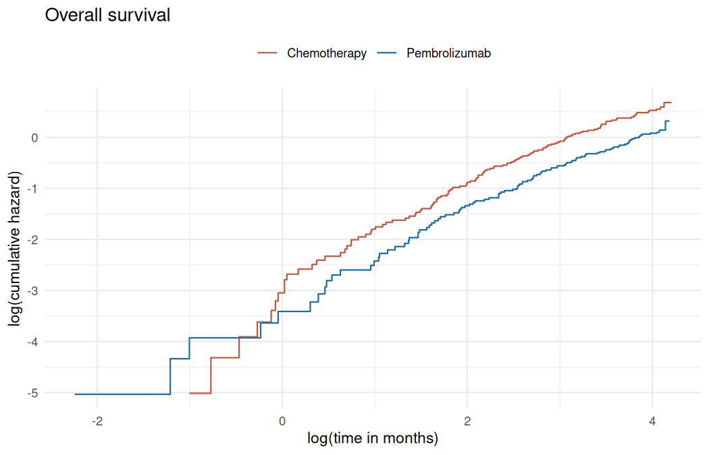
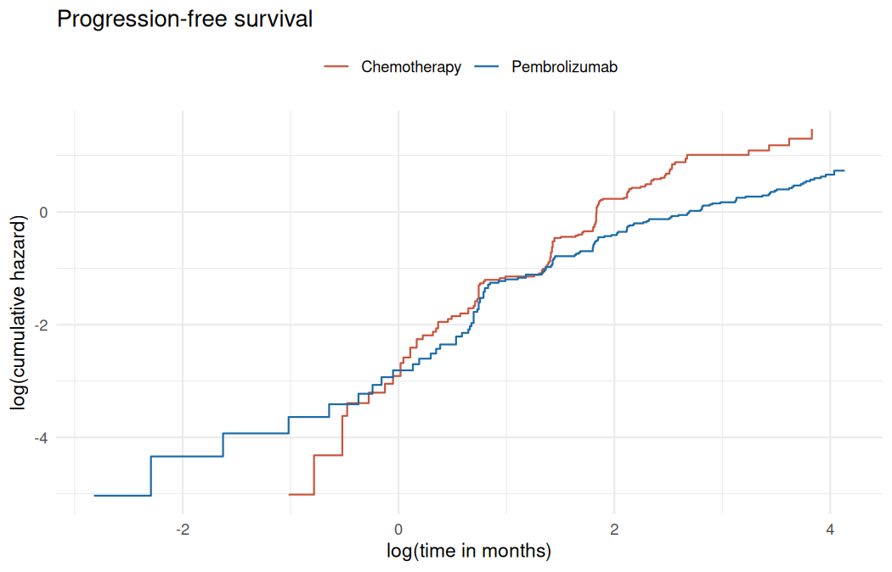
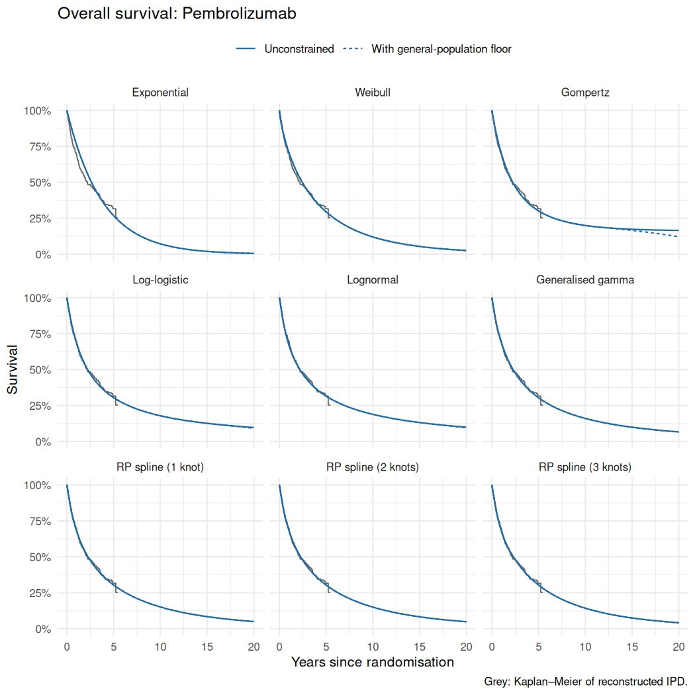
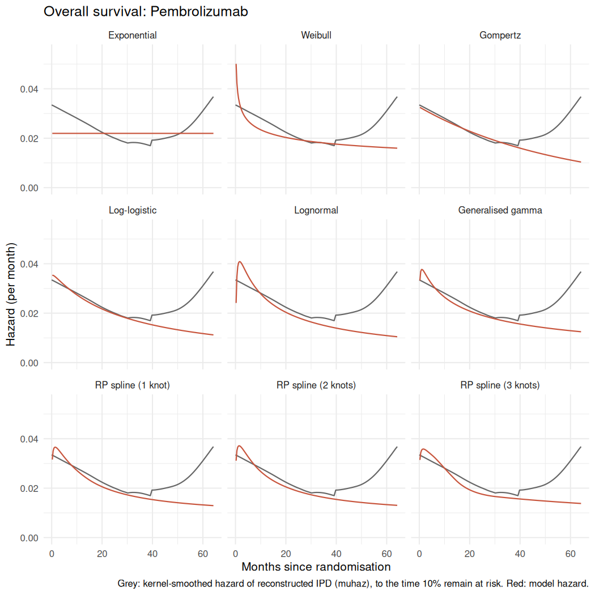
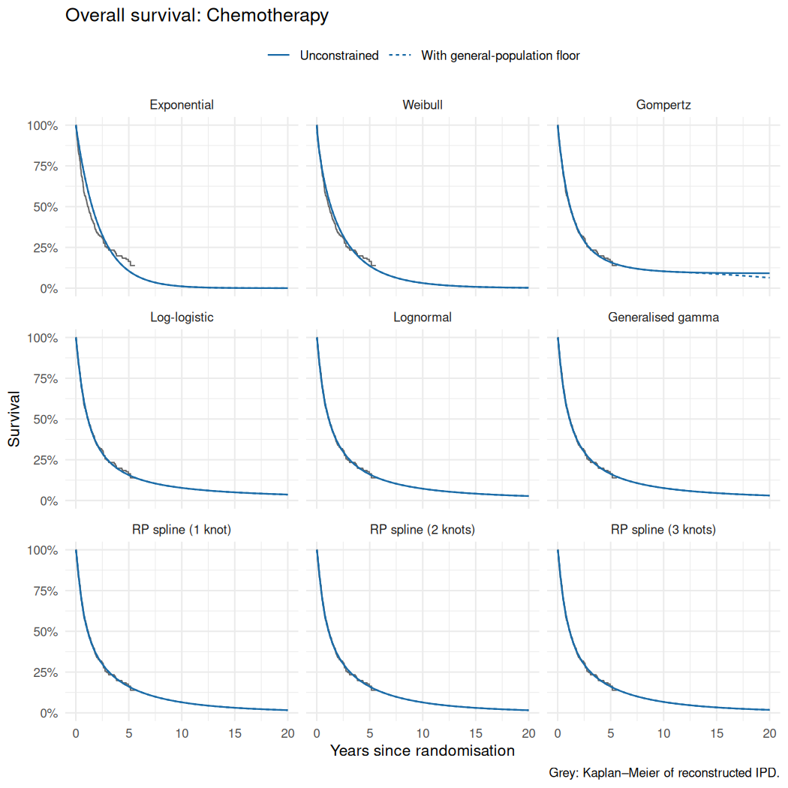
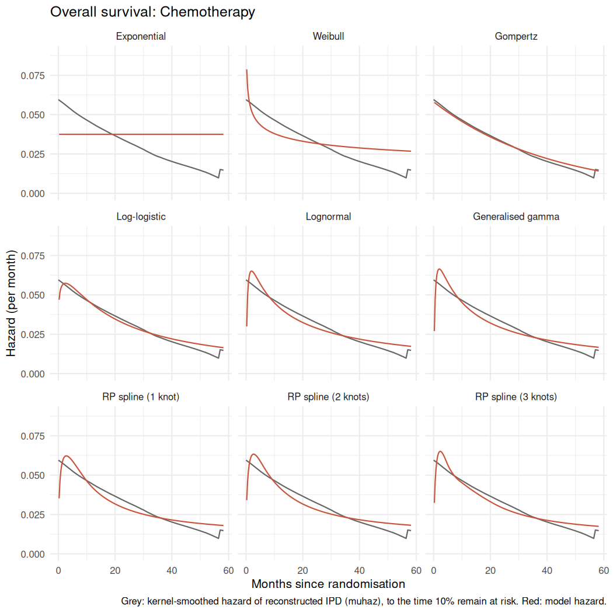
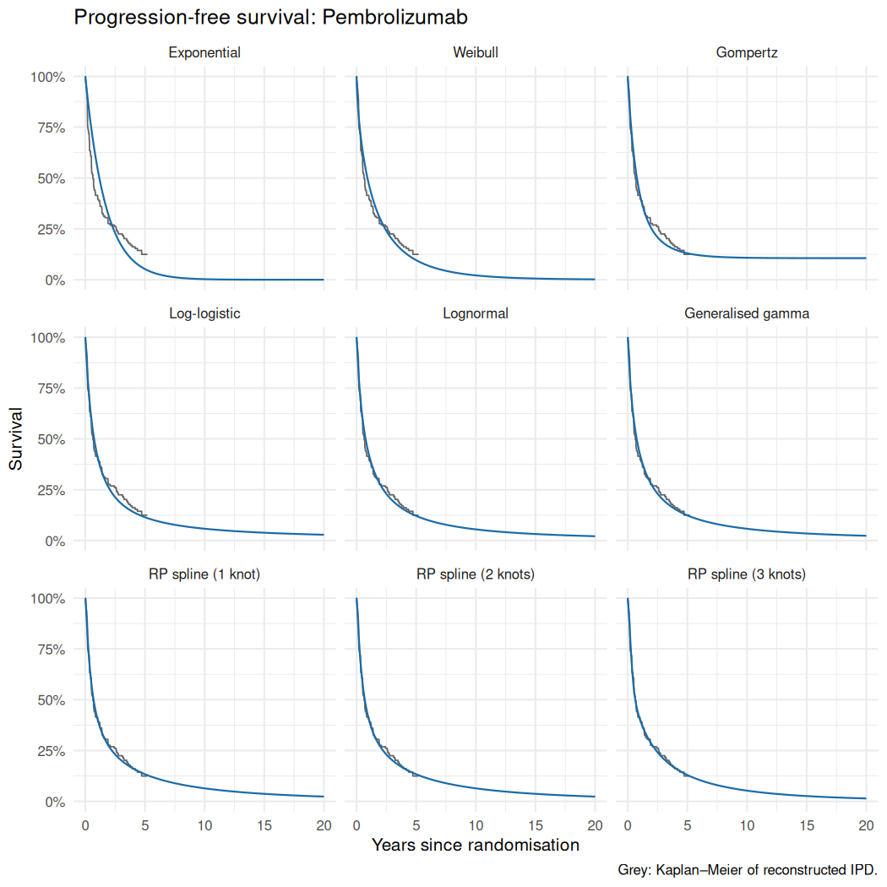
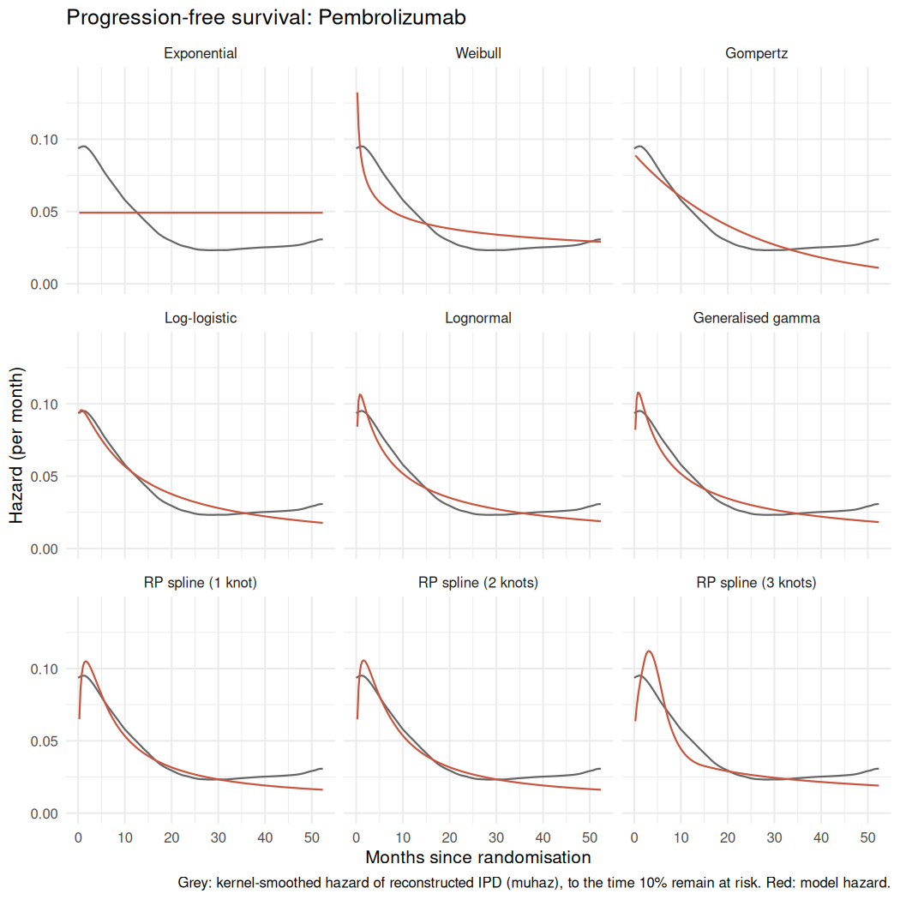
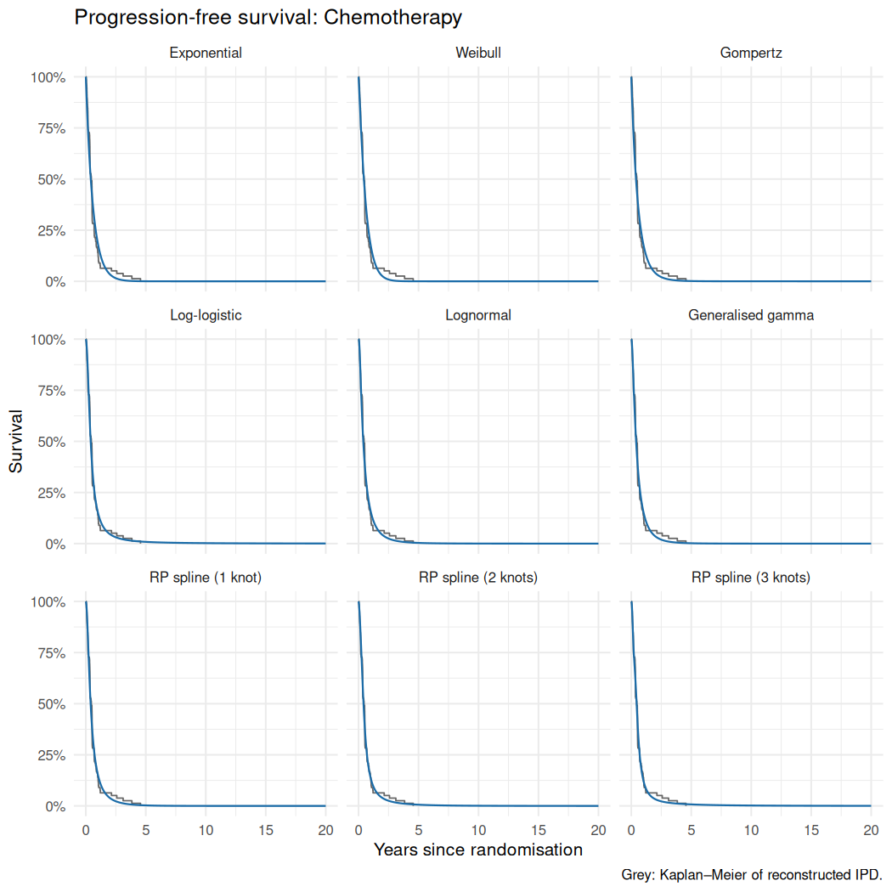
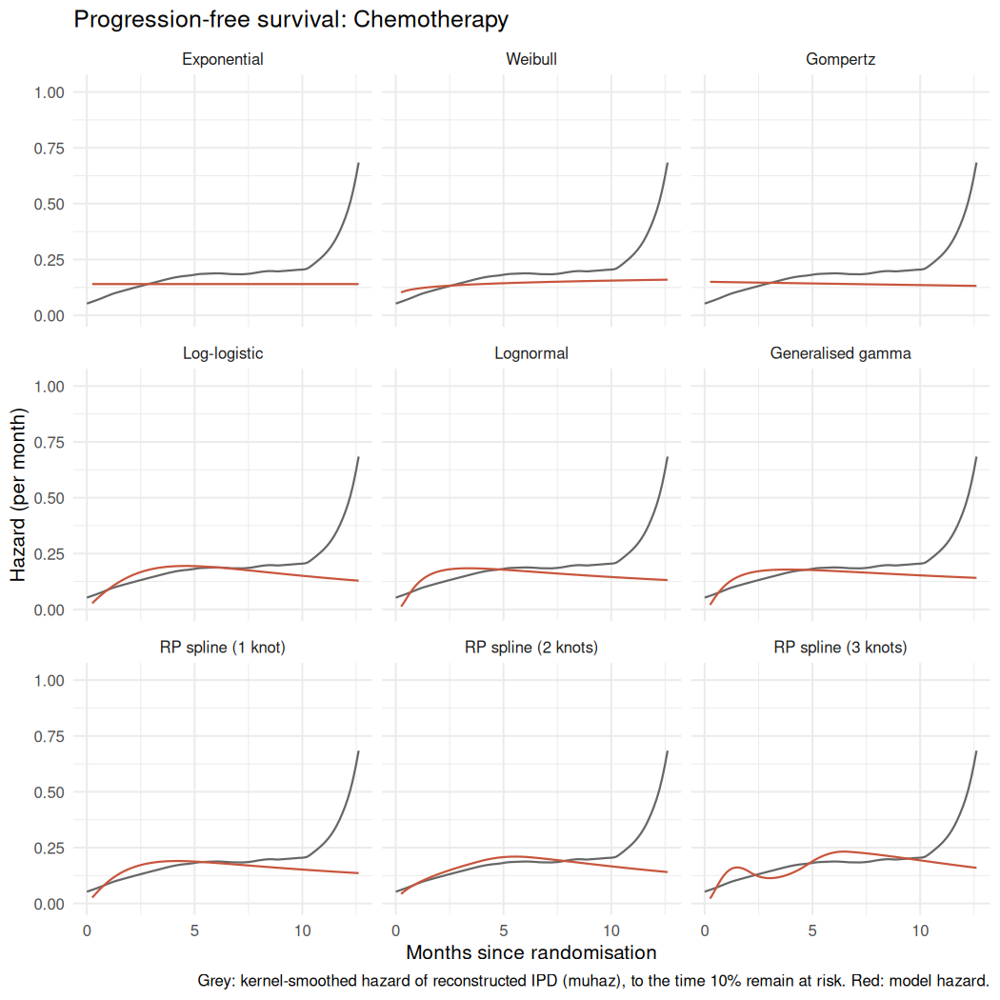

# Survival extrapolation: model-selection evidence

Models were fitted separately to each arm of the reconstructed KEYNOTE-024 IPD
(Reck et al. 2021, data cut-off 1 June 2020), following NICE DSU TSD 14 and TSD 21.
Candidates: exponential, Weibull, Gompertz, log-logistic, lognormal, generalised
gamma, and Royston–Parmar splines on the hazard scale with 1–3 internal knots.

General-population mortality: ONS National Life Tables, England, 2022-2024, for a cohort aged 65 at baseline with 64.6% male.
OS columns marked *constrained* apply this mortality floor. PFS is shown
unconstrained, because its cap at OS depends on the OS model chosen.

Survival values are percentages. RMST is restricted mean survival to 20 years, in months.

## Proportional hazards (Grambsch–Therneau test on the treatment term)

| Endpoint | Chi-squared | p-value |
|---|---|---|
| Overall survival | 0.19 | 0.660 |
| Progression-free survival | 10.99 | 0.001 |

## Overall survival: Pembrolizumab

Observed KM at 5 years: 31.6%.

| Model | AIC | ΔAIC | BIC | ΔBIC | 5y | 10y | 20y | RMST | 5y constrained | 10y constrained | 20y constrained | RMST constrained | Floor binds from (years) |
|---|---|---|---|---|---|---|---|---|---|---|---|---|---|
| Log-logistic | 1015.1 | 0.0 | 1021.2 | 0.0 | 30.5 | 17.8 | 9.7 | 60.8 | 30.5 | 17.8 | 9.1 | 60.7 | 16.8 |
| Lognormal | 1015.9 | 0.8 | 1022.0 | 0.8 | 31.5 | 18.8 | 9.9 | 62.0 | 31.5 | 18.8 | 9.5 | 62.0 | 17.0 |
| Gompertz | 1016.2 | 1.1 | 1022.3 | 1.1 | 30.1 | 19.9 | 16.5 | 66.9 | 30.1 | 19.9 | 12.2 | 65.4 | 12.0 |
| RP spline (1 knot) | 1016.3 | 1.2 | 1025.4 | 4.2 | 30.4 | 15.1 | 5.0 | 55.2 | 30.4 | 15.1 | 5.0 | 55.2 | – |
| Generalised gamma | 1016.6 | 1.5 | 1025.7 | 4.5 | 30.4 | 16.0 | 6.6 | 57.1 | 30.4 | 16.0 | 6.6 | 57.1 | 19.0 |
| Weibull | 1017.4 | 2.3 | 1023.5 | 2.3 | 29.4 | 12.0 | 2.5 | 50.8 | 29.4 | 12.0 | 2.5 | 50.8 | – |
| RP spline (2 knots) | 1018.3 | 3.2 | 1030.4 | 9.2 | 30.4 | 15.0 | 4.9 | 55.0 | 30.4 | 15.0 | 4.9 | 55.0 | – |
| RP spline (3 knots) | 1020.1 | 5.0 | 1035.3 | 14.1 | 30.4 | 14.3 | 4.1 | 53.9 | 30.4 | 14.3 | 4.1 | 53.9 | – |
| Exponential | 1023.6 | 8.5 | 1026.6 | 5.4 | 26.8 | 7.2 | 0.5 | 45.3 | 26.8 | 7.2 | 0.5 | 45.3 | – |

## Overall survival: Chemotherapy

Observed KM at 5 years: 16.4%.

| Model | AIC | ΔAIC | BIC | ΔBIC | 5y | 10y | 20y | RMST | 5y constrained | 10y constrained | 20y constrained | RMST constrained | Floor binds from (years) |
|---|---|---|---|---|---|---|---|---|---|---|---|---|---|
| Lognormal | 1045.1 | 0.0 | 1051.1 | 0.0 | 16.0 | 7.2 | 2.7 | 34.2 | 16.0 | 7.2 | 2.7 | 34.2 | – |
| Generalised gamma | 1047.0 | 1.9 | 1056.1 | 5.0 | 16.3 | 7.6 | 3.1 | 34.8 | 16.3 | 7.6 | 3.0 | 34.8 | 19.0 |
| Log-logistic | 1047.4 | 2.4 | 1053.5 | 2.4 | 15.6 | 7.7 | 3.7 | 35.0 | 15.6 | 7.7 | 3.6 | 35.0 | 17.9 |
| RP spline (1 knot) | 1048.4 | 3.3 | 1057.4 | 6.3 | 16.1 | 6.5 | 1.7 | 32.8 | 16.1 | 6.5 | 1.7 | 32.8 | – |
| Gompertz | 1049.2 | 4.1 | 1055.2 | 4.1 | 15.9 | 10.3 | 9.1 | 41.0 | 15.9 | 10.3 | 6.4 | 39.9 | 11.0 |
| RP spline (2 knots) | 1050.3 | 5.2 | 1062.4 | 11.3 | 16.1 | 6.4 | 1.6 | 32.7 | 16.1 | 6.4 | 1.6 | 32.7 | – |
| RP spline (3 knots) | 1052.1 | 7.1 | 1067.2 | 16.1 | 16.1 | 6.7 | 1.8 | 33.1 | 16.1 | 6.7 | 1.8 | 33.1 | – |
| Weibull | 1056.5 | 11.4 | 1062.5 | 11.4 | 13.7 | 3.1 | 0.2 | 28.7 | 13.7 | 3.1 | 0.2 | 28.7 | – |
| Exponential | 1064.5 | 19.4 | 1067.5 | 16.4 | 10.6 | 1.1 | 0.0 | 26.7 | 10.6 | 1.1 | 0.0 | 26.7 | – |

## Progression-free survival: Pembrolizumab

Observed KM at 5 years: 12.5%.

| Model | AIC | ΔAIC | BIC | ΔBIC | 5y | 10y | 20y | RMST |
|---|---|---|---|---|---|---|---|---|
| RP spline (1 knot) | 987.7 | 0.0 | 996.8 | 1.2 | 13.4 | 6.4 | 2.4 | 28.5 |
| RP spline (3 knots) | 989.1 | 1.4 | 1004.3 | 8.7 | 13.0 | 5.3 | 1.5 | 26.8 |
| Lognormal | 989.5 | 1.8 | 995.6 | 0.0 | 12.1 | 5.5 | 2.1 | 27.2 |
| RP spline (2 knots) | 989.8 | 2.1 | 1002.0 | 6.4 | 13.4 | 6.4 | 2.4 | 28.5 |
| Log-logistic | 989.8 | 2.2 | 995.9 | 0.3 | 11.5 | 5.8 | 2.9 | 27.2 |
| Generalised gamma | 991.5 | 3.8 | 1000.6 | 5.0 | 12.4 | 5.8 | 2.4 | 27.7 |
| Gompertz | 995.0 | 7.3 | 1001.0 | 5.4 | 13.0 | 10.8 | 10.6 | 37.5 |
| Weibull | 1005.3 | 17.6 | 1011.4 | 15.8 | 9.6 | 2.1 | 0.2 | 22.6 |
| Exponential | 1029.2 | 41.6 | 1032.3 | 36.7 | 5.2 | 0.3 | 0.0 | 20.3 |

## Progression-free survival: Chemotherapy

Observed KM at 5 years: –%.

| Model | AIC | ΔAIC | BIC | ΔBIC | 5y | 10y | 20y | RMST |
|---|---|---|---|---|---|---|---|---|
| RP spline (3 knots) | 820.1 | 0.0 | 835.2 | 4.7 | 0.8 | 0.2 | 0.0 | 7.5 |
| Log-logistic | 824.4 | 4.3 | 830.4 | 0.0 | 0.9 | 0.2 | 0.1 | 7.9 |
| RP spline (2 knots) | 825.4 | 5.3 | 837.5 | 7.0 | 0.6 | 0.1 | 0.0 | 7.4 |
| Lognormal | 825.5 | 5.4 | 831.5 | 1.1 | 0.3 | 0.0 | 0.0 | 7.4 |
| RP spline (1 knot) | 826.6 | 6.5 | 835.7 | 5.2 | 0.3 | 0.0 | 0.0 | 7.2 |
| Generalised gamma | 826.8 | 6.7 | 835.8 | 5.4 | 0.2 | 0.0 | 0.0 | 7.2 |
| Weibull | 843.2 | 23.1 | 849.2 | 18.7 | 0.0 | 0.0 | 0.0 | 7.1 |
| Exponential | 844.2 | 24.1 | 847.2 | 16.7 | 0.0 | 0.0 | 0.0 | 7.1 |
| Gompertz | 845.0 | 25.0 | 851.1 | 20.6 | 0.1 | 0.0 | 0.0 | 7.2 |

## TA531-style piecewise scenario (KM to cut-off, exponential tail)

| Endpoint | Arm | Cut-off (weeks) | At risk at cut-off | Events after | KM at cut-off | 5y | 10y | 20y | RMST | 5y constrained | 10y constrained | 20y constrained | RMST constrained |
|---|---|---|---|---|---|---|---|---|---|---|---|---|---|
| OS | Pembrolizumab | 23 | 124 | 79 | 82.3 | 28.6 | 9.0 | 0.9 | 47.0 | 28.6 | 9.0 | 0.9 | 46.9 |
| OS | Pembrolizumab | 33 | 115 | 70 | 76.3 | 29.2 | 9.7 | 1.1 | 47.7 | 29.1 | 9.7 | 1.1 | 47.6 |
| OS | Pembrolizumab | 43 | 111 | 66 | 73.7 | 29.1 | 9.5 | 1.0 | 47.5 | 29.0 | 9.5 | 1.0 | 47.4 |
| OS | Chemotherapy | 23 | 113 | 87 | 75.4 | 12.2 | 1.7 | 0.0 | 27.3 | 12.2 | 1.7 | 0.0 | 27.3 |
| OS | Chemotherapy | 33 | 99 | 73 | 66.1 | 13.2 | 2.1 | 0.1 | 27.7 | 13.2 | 2.1 | 0.1 | 27.7 |
| OS | Chemotherapy | 43 | 84 | 59 | 56.7 | 14.5 | 2.8 | 0.1 | 28.4 | 14.5 | 2.8 | 0.1 | 28.4 |
| PFS | Pembrolizumab | 23 | 94 | 70 | 62.0 | 8.8 | 1.0 | 0.0 | 21.6 | – | – | – | – |
| PFS | Pembrolizumab | 33 | 76 | 52 | 50.2 | 10.8 | 1.8 | 0.1 | 22.5 | – | – | – | – |
| PFS | Pembrolizumab | 43 | 65 | 42 | 43.5 | 11.8 | 2.5 | 0.1 | 23.2 | – | – | – | – |
| PFS | Chemotherapy | 23 | 76 | 69 | 51.2 | 0.0 | 0.0 | 0.0 | 7.1 | – | – | – | – |
| PFS | Chemotherapy | 33 | 42 | 35 | 28.3 | 0.0 | 0.0 | 0.0 | 7.2 | – | – | – | – |
| PFS | Chemotherapy | 43 | 28 | 22 | 19.5 | 0.1 | 0.0 | 0.0 | 7.2 | – | – | – | – |

