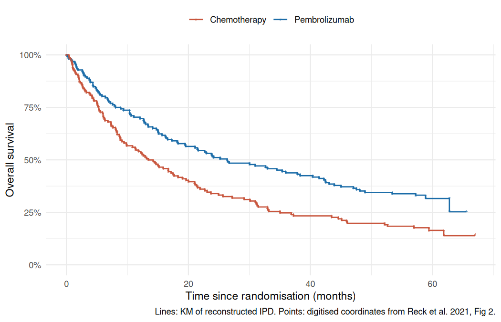
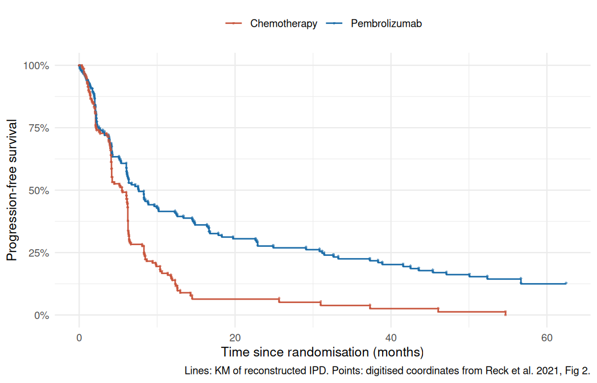

# IPD reconstruction: validation

Reconstructed from digitised Figure 2A (OS) and 2B (PFS) of Reck et al.,
*J Clin Oncol* 2021;39(21):2339–2349 (data cut-off 1 June 2020), with the
Guyot et al. (2012) algorithm.

**Overall result: all acceptance checks passed**

## Acceptance thresholds (pre-specified; DECISIONS.md D-001, D-003)

- Median survival: within 1 month of the published value, in each arm.
- Hazard ratio: within 0.03 of the published HR.
- Landmark survival: within 3 percentage points, only where Reck 2021 reports the value.

The published HRs come from a Cox model stratified by ECOG PS, histology and
region. The reconstructed data contain no stratification factors, so the
reconstructed HR comes from an unstratified Cox model (Efron ties). Both
estimates are intention-to-treat and neither adjusts for crossover (D-005).

## Implementation

- os / pembro: `IPDfromKM::getIPD`
- os / chemo: `IPDfromKM::getIPD`
- pfs / pembro: `IPDfromKM::getIPD`
- pfs / chemo: `IPDfromKM::getIPD`

## OS

Survival values are percentages.

| Check | Published | Reconstructed | Abs. difference | Threshold | Result |
|---|---|---|---|---|---|
| Median (pembro), months | 26.30 | 26.35 | 0.054 | 1.00 | PASS |
| Median (chemo), months | 13.40 | 13.44 | 0.036 | 1.00 | PASS |
| HR pembro vs chemo (unstratified Cox) | 0.62 | 0.64 | 0.016 | 0.03 | PASS |
| HR lower 95% CI | 0.48 | 0.49 | 0.010 | – | report only |
| HR upper 95% CI | 0.81 | 0.83 | 0.015 | – | report only |
| Total events (pembro) | 103 | 106 | 3 | – | report only |
| Total events (chemo) | 123 | 124 | 1 | – | report only |
| 1-year survival (pembro) | – | 70.3 | – | – | report only |
| 2-year survival (pembro) | – | 51.8 | – | – | report only |
| 5-year survival (pembro) | 31.9 | 31.6 | 0.3 | 3.0 | PASS |
| 1-year survival (chemo) | – | 54.0 | – | – | report only |
| 2-year survival (chemo) | – | 33.9 | – | – | report only |
| 5-year survival (chemo) | 16.3 | 16.4 | 0.1 | 3.0 | PASS |

### OS numbers at risk

| Arm | Time (months) | Published at risk | Reconstructed at risk |
|---|---|---|---|
| pembro | 0 | 154 | 154 |
| pembro | 6 | 121 | 121 |
| pembro | 12 | 106 | 106 |
| pembro | 18 | 89 | 89 |
| pembro | 24 | 78 | 78 |
| pembro | 30 | 73 | 73 |
| pembro | 36 | 66 | 66 |
| pembro | 42 | 62 | 62 |
| pembro | 48 | 54 | 54 |
| pembro | 54 | 51 | 51 |
| pembro | 60 | 20 | 20 |
| pembro | 66 | 0 | 0 |
| pembro | 72 | 0 | 0 |
| chemo | 0 | 151 | 151 |
| chemo | 6 | 108 | 108 |
| chemo | 12 | 80 | 80 |
| chemo | 18 | 61 | 61 |
| chemo | 24 | 48 | 48 |
| chemo | 30 | 44 | 44 |
| chemo | 36 | 35 | 35 |
| chemo | 42 | 33 | 33 |
| chemo | 48 | 28 | 28 |
| chemo | 54 | 26 | 26 |
| chemo | 60 | 13 | 13 |
| chemo | 66 | 3 | 3 |
| chemo | 72 | 0 | 0 |

## PFS

Survival values are percentages.

| Check | Published | Reconstructed | Abs. difference | Threshold | Result |
|---|---|---|---|---|---|
| Median (pembro), months | 7.70 | 7.65 | 0.047 | 1.00 | PASS |
| Median (chemo), months | 5.50 | 5.49 | 0.013 | 1.00 | PASS |
| HR pembro vs chemo (unstratified Cox) | 0.50 | 0.50 | 0.003 | 0.03 | PASS |
| HR lower 95% CI | 0.39 | 0.39 | 0.001 | – | report only |
| HR upper 95% CI | 0.65 | 0.65 | 0.001 | – | report only |
| Total events (pembro) | 126 | 128 | 2 | – | report only |
| Total events (chemo) | 141 | 142 | 1 | – | report only |
| 1-year survival (pembro) | – | 41.5 | – | – | report only |
| 2-year survival (pembro) | – | 27.6 | – | – | report only |
| 3-year survival (pembro) | 22.8 | 22.5 | 0.3 | 3.0 | PASS |
| 5-year survival (pembro) | 12.8 | 12.5 | 0.3 | 3.0 | PASS |
| 1-year survival (chemo) | – | 13.9 | – | – | report only |
| 2-year survival (chemo) | – | 6.4 | – | – | report only |
| 3-year survival (chemo) | 4.1 | 3.8 | 0.3 | 3.0 | PASS |
| 5-year survival (chemo) | – | – | – | – | report only |

### PFS numbers at risk

| Arm | Time (months) | Published at risk | Reconstructed at risk |
|---|---|---|---|
| pembro | 0 | 154 | 154 |
| pembro | 6 | 92 | 92 |
| pembro | 12 | 62 | 62 |
| pembro | 18 | 46 | 46 |
| pembro | 24 | 38 | 38 |
| pembro | 30 | 36 | 36 |
| pembro | 36 | 30 | 30 |
| pembro | 42 | 24 | 24 |
| pembro | 48 | 20 | 20 |
| pembro | 54 | 15 | 15 |
| pembro | 60 | 3 | 3 |
| pembro | 66 | 0 | 0 |
| chemo | 0 | 151 | 151 |
| chemo | 6 | 73 | 73 |
| chemo | 12 | 20 | 20 |
| chemo | 18 | 6 | 5 |
| chemo | 24 | 5 | 5 |
| chemo | 30 | 4 | 4 |
| chemo | 36 | 3 | 3 |
| chemo | 42 | 2 | 2 |
| chemo | 48 | 1 | 1 |
| chemo | 54 | 1 | 1 |
| chemo | 60 | 0 | 0 |
| chemo | 66 | 0 | 0 |

## Cleaning log (DECISIONS.md D-002, D-006)

| Curve | Rule | Points | Detail |
|---|---|---|---|
| os_pembro | origin_added | 1 | (0, 1) |
| os_chemo | origin_added | 1 | (0, 1) |
| pfs_pembro | origin_added | 1 | (0, 1) |
| pfs_chemo | origin_added | 1 | (0, 1) |
