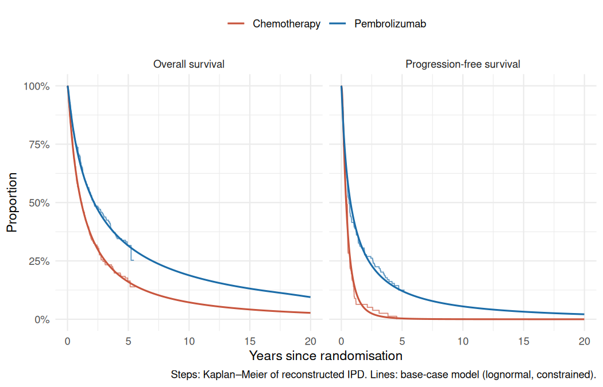
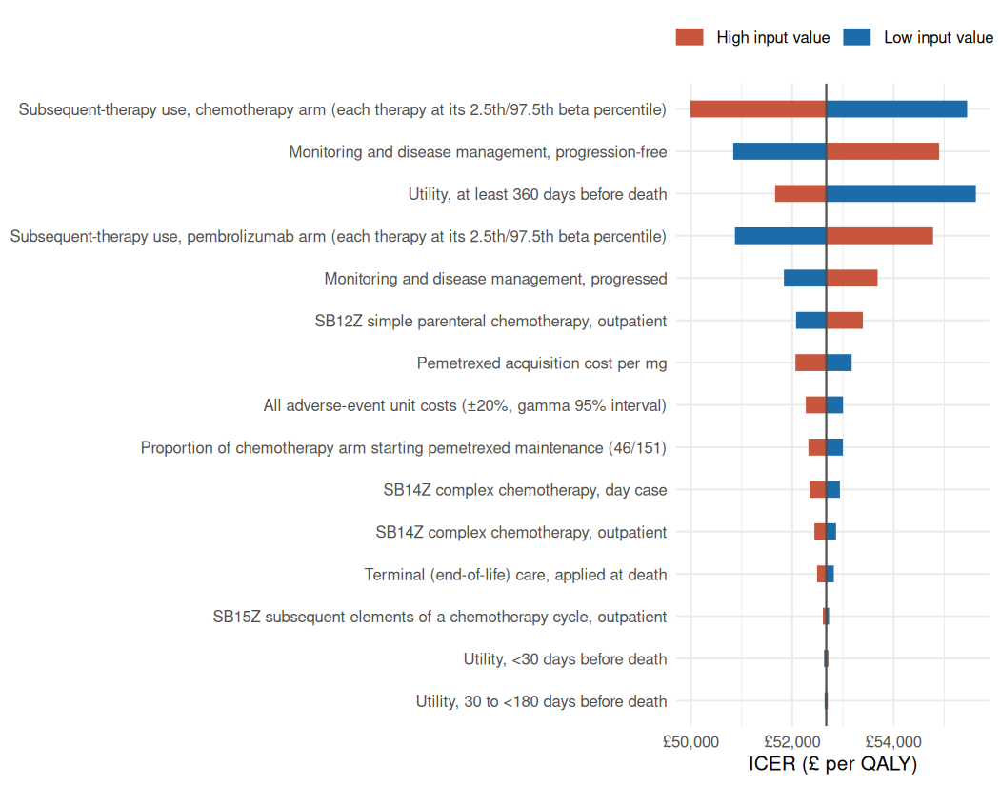
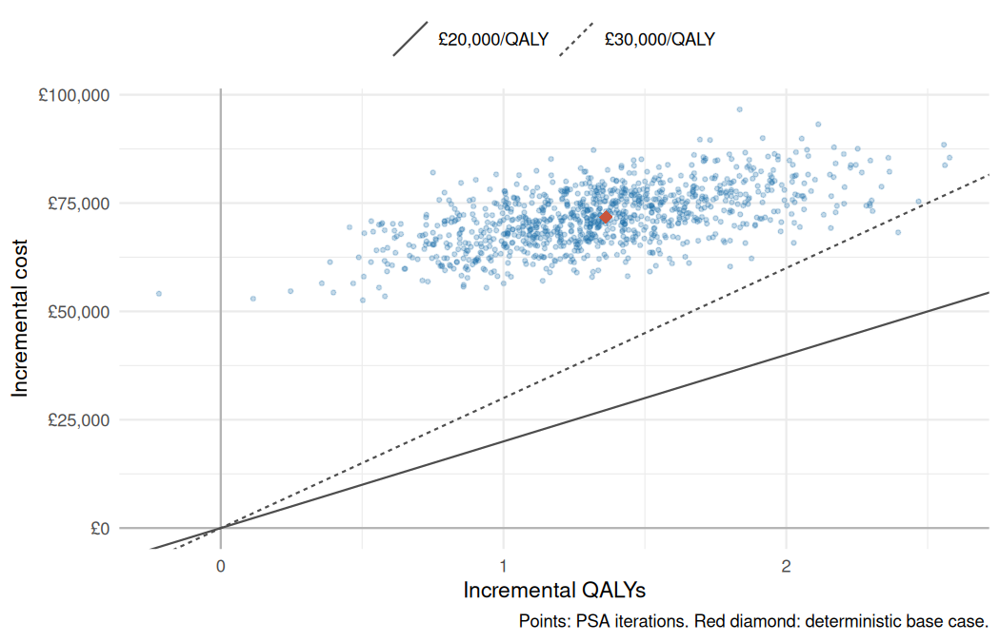
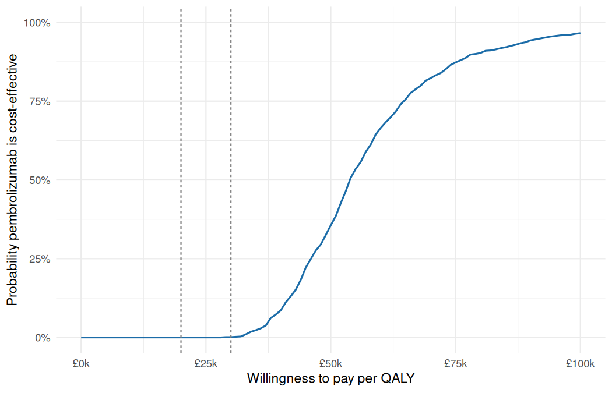

```{r setup}
library(targets)
# Rendered by tar_quarto() from the project root, or directly from report/.
store <- if (dir.exists("_targets")) "_targets" else "../_targets"
facts <- tar_read(facts, store = store)
base <- tar_read(base_case, store = store)
params <- tar_read(params, store = store)
inputs <- tar_read(model_data, store = store)$inputs
validation <- tar_read(validation, store = store)
selection <- tar_read(selection, store = store)
ph <- tar_read(ph, store = store)
scen <- tar_read(scenarios, store = store)
owsa <- tar_read(owsa, store = store)
psa <- tar_read(psa, store = store)
ce <- tar_read(psa_ceac, store = store)
thr <- tar_read(thresholds, store = store)
val <- tar_read(validation_ta531, store = store)
mtime <- tar_read(mtime, store = store)
diag <- tar_read(diagnostics, store = store)

gbp <- function(x, d = 0) paste0(ifelse(x < 0, "−£", "£"), formatC(abs(x), format = "f", digits = d, big.mark = ","))
num <- function(x, d = 1) formatC(x, format = "f", digits = d, big.mark = ",")
pct <- function(x, d = 1) paste0(formatC(100 * x, format = "f", digits = d), "%")
fct <- function(key, d = NULL) { v <- facts[[key]]; if (is.null(d)) format(v, big.mark = ",") else num(v, d) }

inc <- base$summary$incremental
tot <- base$summary$totals
uc <- base$run$unit_costs
sel <- dplyr::bind_rows(selection)
chk <- dplyr::bind_rows(lapply(validation, `[[`, "checks"))
psa_icer <- mean(psa$inc_cost) / mean(psa$inc_qaly)
p_ce <- function(k) ce$p_ce[ce$wtp == k]
sc <- function(name, col = "icer") scen[[col]][scen$scenario == name]
```

::: {.callout-note}
This is an independent model built from public sources. It is **not** the
model submitted to NICE and its results are **not** NICE's results. The
appraisal's decision-making ICERs include confidential discounts that are
not public. This model uses list prices throughout.
:::

# Decision problem

| Element | Specification |
|---|---|
| Population | Adults with untreated metastatic non-small-cell lung cancer (NSCLC), PD-L1 tumour proportion score ≥ 50%, no EGFR or ALK aberrations (KEYNOTE-024 population) |
| Intervention | Pembrolizumab `r num(params$pembro_dose_mg, 0)` mg every `r num(params$pembro_interval_weeks, 0)` weeks until progression, to a maximum of `r num(params$pembro_max_doses, 0)` administrations (2 years) |
| Comparator | Platinum-based chemotherapy as given in KEYNOTE-024 (carboplatin or cisplatin with pemetrexed, gemcitabine or paclitaxel; optional pemetrexed maintenance) |
| Outcomes | Life years, quality-adjusted life years (QALYs), costs |
| Perspective | NHS and Personal Social Services (England) |
| Time horizon | `r num(params$horizon_years, 0)` years (`r format(mtime$n_cycles, big.mark = ",")` weekly cycles) |
| Discounting | `r pct(params$discount_costs)` per year for costs and QALYs, at cycle midpoints |
| Half-cycle correction | Trapezoidal (life-table) method: occupancy in each cycle is the mean of state membership at its start and end |
| Prices | List prices (2024/25 unit costs; eMIT 2025/26 for generic drugs) |

The structure mirrors the company model accepted in NICE technology appraisal
TA531: a three-state partitioned survival model with weekly cycles, a
`r fct("ta531_horizon_years")`-year horizon, a 2-year
(`r fct("ta531_max_cycles")`-cycle) stopping rule for pembrolizumab, and
utilities based on time to death. Clinical inputs come from the five-year
KEYNOTE-024 analysis (Reck et al. 2021; data cut-off 1 June 2020; median
follow-up `r fct("followup_median_months", 1)` months), not the July 2017
data used in the appraisal.

# Methods

## Individual patient data

Kaplan–Meier (KM) curves for overall survival (OS, Figure 2A) and
progression-free survival (PFS, Figure 2B) of Reck et al. (2021) were
extracted from the vector artwork in the article PDF (PMC Open Access copy).
Each arm's step path was read directly, with axes calibrated on the drawn tick
marks. The numbers at risk were taken from the PDF's text layer.
Individual patient data (IPD) were reconstructed with the Guyot et al. (2012)
algorithm (`IPDfromKM::getIPD`), with the randomised numbers
(`r fct("n_pembro")` and `r fct("n_chemo")`) and the event totals reported for
the same data cut.

Acceptance thresholds were set before reconstruction: medians within
`r num(diag$acceptance$median_months, 0)` month, hazard ratios within
`r num(diag$acceptance$hr, 2)`, and landmark survival within
`r num(100 * diag$acceptance$landmark_abs, 0)` percentage points where the
paper reports it.

## Survival extrapolation

Following NICE DSU TSD 14 and TSD 21, nine models were fitted separately to
each arm and endpoint: exponential, Weibull, Gompertz, log-logistic,
lognormal, generalised gamma, and Royston–Parmar splines on the hazard scale
with one to three internal knots. Selection considered AIC and BIC, visual
fit, smoothed hazards, log-cumulative-hazard plots, and the plausibility of
extrapolated survival at 5, 10 and 20 years.

Two constraints apply in every cycle:

* the OS hazard is never below general-population mortality for a cohort aged
  `r num(params$start_age, 0)` with `r pct(params$prop_male)` male (the
  TA531 company model's baseline), from the ONS National Life Tables for
  England, 2022–2024;
* PFS never exceeds OS.

## Treatment duration

KEYNOTE-024 time-on-treatment curves are not public. Time on pembrolizumab
is therefore **assumed** equal to PFS, capped at
`r num(params$pembro_max_doses, 0)` doses. Chemotherapy is given for up to
`r num(params$chemo_max_cycles, 0)` three-weekly cycles while progression-free,
which gives a modelled mean of `r num(diag$mean_chemo_cycles, 2)` cycles
(the mean observed in KEYNOTE-024 was `r num(params$subsequent_doublet_cycles, 2)`). The modelled mean number of
pembrolizumab administrations is `r num(diag$mean_pembro_doses, 1)`.
`r pct(params$pem_maint_prop)` of the chemotherapy arm
(`r fct("pem_maint_n")` of `r fct("n_chemo")`) continue on pemetrexed
maintenance while progression-free.

## Health-related quality of life

Utilities come from KEYNOTE-024 EQ-5D-3L data as reported in the TA531
committee papers, pooled across arms and grouped by time to death:
`r num(params$u_ttd_360, 3)` (≥360 days), `r num(params$u_ttd_180, 3)`
(180–360), `r num(params$u_ttd_30, 3)` (30–180) and `r num(params$u_ttd_0, 3)`
(<30 days). For people alive in each cycle, the probability of being in each
band is derived from that arm's OS curve. The ≥360-day value is capped at the
general-population EQ-5D norm for the cohort's age and sex, as the committee
preferred. All utilities are age-adjusted multiplicatively using the NICE DSU
(2022) EQ-5D-3L norms. Progression-based utilities (`r num(params$u_pf, 3)`
and `r num(params$u_pd, 3)`) are a scenario.

## Costs

All costs are in 2024/25 prices, at list price.

| Item | Value | Source |
|---|---|---|
| Pembrolizumab, per administration (acquisition) | `r gbp(uc$pembro_drug_dose, 2)` | dm+d/BNF list price `r gbp(params$price_pembro_100mg)` per 100 mg; dose intensity `r pct(params$dose_intensity_pembro, 2)` |
| Administration, simple outpatient (SB12Z) | `r gbp(params$admin_sb12z_op, 2)` | National Cost Collection 2024/25 |
| Chemotherapy per cycle (drug + administration, KEYNOTE-024 mix) | `r gbp(uc$chemo_cycle, 2)` | eMIT 2025/26; NCC 2024/25; TA531 regimen mix |
| Pemetrexed maintenance, per administration | `r gbp(uc$pem_maint_dose, 2)` | eMIT 2025/26; NCC 2024/25 |
| Monitoring, progression-free (per week) | `r gbp(uc$pf_week, 2)` | TA531 resource use, uprated with the NHS Cost Inflation Index |
| Monitoring, progressed (per week) | `r gbp(uc$pd_week, 2)` | As above |
| Terminal care (one-off at death) | `r gbp(uc$terminal, 2)` | As above |
| Adverse events (one-off), pembrolizumab / chemotherapy | `r gbp(uc$ae_pembro, 2)` / `r gbp(uc$ae_chemo, 2)` | TA531 AE rates and unit costs, uprated |
| Subsequent anti-PD-(L)1 course | `r gbp(uc$subsequent_course[[1]], 2)` | `r num(params$subsequent_io_weeks, 1)` weeks of pembrolizumab |

Subsequent therapy follows the use reported in KEYNOTE-024 (Reck 2021,
Appendix Table A1). In the chemotherapy arm,
`r pct(params$subsq_prop_chemo[[1]])` received anti-PD-(L)1 therapy
(`r fct("crossover_pct", 1)`% effective crossover), so costs stay consistent
with the trial survival. These costs are applied at each PFS event.

# Survival analysis

## Reconstruction

```{r recon-table}
fmt_chk <- function(x, check) {
  out <- ifelse(grepl("survival", check), num(100 * x),
                ifelse(grepl("events", check), num(x, 0), num(x, 2)))
  ifelse(is.na(x), "–", out)
}
knitr::kable(
  data.frame(Endpoint = toupper(chk$endpoint), Check = chk$check,
             Published = fmt_chk(chk$published, chk$check),
             Reconstructed = fmt_chk(chk$reconstructed, chk$check),
             Result = ifelse(is.na(chk$pass), "report only", ifelse(chk$pass, "pass", "FAIL")))[
    !grepl("CI", chk$check), ],
  row.names = FALSE, caption = "Reconstructed IPD against published KEYNOTE-024 results (survival in %).")
```

`r if (all(chk$pass, na.rm = TRUE)) "Every pre-specified check passed." else "One or more pre-specified checks failed."`
The published hazard ratios come from Cox
models stratified by ECOG performance status, histology and region. The
reconstructed hazard ratios are unstratified, because the reconstructed data
carry no stratification factors.

## Model selection

```{r sel-table}
s <- sel[sel$endpoint == "os", ]
s <- s[order(s$endpoint, s$arm, s$aic), ]
knitr::kable(
  data.frame(Arm = ifelse(s$arm == "pembro", "Pembrolizumab", "Chemotherapy"), Model = s$model,
             `ΔAIC` = num(s$delta_aic), `ΔBIC` = num(s$delta_bic),
             `5 years` = pct(s$s_5y_constrained), `10 years` = pct(s$s_10y_constrained),
             `20 years` = pct(s$s_20y_constrained), check.names = FALSE),
  row.names = FALSE,
  caption = "OS models by arm: fit statistics and extrapolated survival with the general-population floor.")
```

The proportional-hazards test on the treatment term gives p =
`r num(ph$os$p, 2)` for OS and p = `r num(ph$pfs$p, 3)` for PFS, where the
curves cross in the first months. Models were fitted separately to each arm.

**Base case: lognormal for OS and PFS in both arms.** For OS it has the
lowest combined AIC across arms and the lowest BIC in the chemotherapy arm.
It reproduces the observed 5-year OS
(`r pct(sel$s_5y[sel$endpoint == "os" & sel$arm == "pembro" & sel$model == "Lognormal"])`
vs a reconstructed KM of `r pct(sel$km_5y[sel$endpoint == "os" & sel$arm == "pembro"][1])`
for pembrolizumab;
`r pct(sel$s_5y[sel$endpoint == "os" & sel$arm == "chemo" & sel$model == "Lognormal"])` vs
`r pct(sel$km_5y[sel$endpoint == "os" & sel$arm == "chemo"][1])` for chemotherapy).
The generalised gamma shape parameter Q includes 0 in its 95% confidence
interval for `r sum(diag$gengamma_q$lower < 0 & diag$gengamma_q$upper > 0)` of
`r nrow(diag$gengamma_q)` curves (OS pembrolizumab:
`r num(diag$gengamma_q$est[diag$gengamma_q$curve == "os_pembro"], 2)`, 95% CI
`r num(diag$gengamma_q$lower[diag$gengamma_q$curve == "os_pembro"], 2)` to
`r num(diag$gengamma_q$upper[diag$gengamma_q$curve == "os_pembro"], 2)`), so the
lognormal is not rejected against its more flexible parent. Gompertz flattens into an implausible plateau. Weibull and
exponential fit poorly. Using the same family in both arms follows TSD 14.



# Results

## Base case

```{r base-table}
rows <- c("Total costs" = "cost_disc", "Life years (discounted)" = "ly_disc",
          "Life years (undiscounted)" = "ly_undisc", "QALYs" = "qaly_disc")
knitr::kable(data.frame(
  Outcome = names(rows),
  Pembrolizumab = c(gbp(tot["pembro", "cost_disc"]), num(tot["pembro", rows[-1]], 2)),
  Chemotherapy = c(gbp(tot["chemo", "cost_disc"]), num(tot["chemo", rows[-1]], 2)),
  Incremental = c(gbp(inc[["inc_cost"]]), num(inc[["inc_ly"]], 2), num(inc[["inc_ly_undisc"]], 2),
                  num(inc[["inc_qaly"]], 2))),
  row.names = FALSE, caption = "Base-case results (discounted unless stated, list prices).")
```

At list prices, pembrolizumab costs `r gbp(inc[["inc_cost"]])` more than
chemotherapy and gives `r num(inc[["inc_qaly"]], 2)` more QALYs. The ICER is
**`r gbp(inc[["icer"]])` per QALY gained**. Net monetary benefit is
`r gbp(inc[["nmb_20000"]])` at £20,000 per QALY and
`r gbp(inc[["nmb_30000"]])` at £30,000 per QALY.

```{r cost-breakdown}
cats <- grep("^cost_disc_", colnames(tot), value = TRUE)
lab <- c(cost_disc_state_pf = "Monitoring, progression-free", cost_disc_state_pd = "Monitoring, progressed",
         cost_disc_drug_1l = "First-line drug acquisition", cost_disc_admin_1l = "First-line administration",
         cost_disc_maintenance = "Pemetrexed maintenance", cost_disc_ae = "Adverse events",
         cost_disc_subsequent = "Subsequent therapy", cost_disc_terminal = "Terminal care")
knitr::kable(data.frame(Category = lab[cats], Pembrolizumab = gbp(tot["pembro", cats]),
                        Chemotherapy = gbp(tot["chemo", cats]),
                        Difference = gbp(tot["pembro", cats] - tot["chemo", cats])),
             row.names = FALSE, caption = "Discounted costs by category.")
```

## One-way sensitivity analysis

Each varying input was set to the 2.5th and 97.5th percentiles of its PSA
distribution. The ICER ranged from
`r gbp(min(c(owsa$icer_low, owsa$icer_high)))` to
`r gbp(max(c(owsa$icer_low, owsa$icer_high)))`. The two most influential
inputs were: `r tolower(diag$owsa_top[1])`; and `r tolower(diag$owsa_top[2])`.



## Probabilistic sensitivity analysis

`r format(nrow(psa), big.mark = ",")` iterations with a fixed seed
(`r num(params$psa_seed, 0)`). Survival parameters were drawn from
multivariate normal distributions using each fit's variance–covariance
matrix, utilities and proportions from beta distributions, and costs from
gamma distributions. The probabilistic ICER (ratio of mean costs to mean
QALYs) is `r gbp(psa_icer)` per QALY, against a deterministic
`r gbp(inc[["icer"]])`. The probability that pembrolizumab is cost-effective
at list price is `r pct(p_ce(20000))` at £20,000 and `r pct(p_ce(30000))` at
£30,000 per QALY.





## Price threshold analysis

Because the confidential discounts are not public, the analysis asks what
price reduction would be needed. A discount on every pembrolizumab
administration (including subsequent anti-PD-(L)1 therapy in the
chemotherapy arm, costed as pembrolizumab) of
**`r pct(thr$discount[thr$threshold == 20000])`** gives an ICER of £20,000
per QALY, and **`r pct(thr$discount[thr$threshold == 30000])`** gives £30,000
per QALY.

# Scenario analyses

```{r scenarios}
knitr::kable(data.frame(Group = scen$group, Scenario = scen$scenario,
                        `Incremental cost` = gbp(scen$inc_cost), `Incremental QALYs` = num(scen$inc_qaly, 2),
                        ICER = gbp(scen$icer), check.names = FALSE),
             row.names = FALSE, caption = paste0("Scenario analyses (base-case ICER ", gbp(inc[["icer"]]), ")."))
```

The scenarios mirror those discussed in TA531. Three points stand out:

* **Piecewise extrapolation.** The TA531 approach (KM to
  `r fct("ta531_cutoff_low_weeks")`, `r fct("ta531_cutoff_base_weeks")` or
  `r fct("ta531_cutoff_high_weeks")` weeks, then exponential) gives ICERs of
  `r gbp(sc("OS: KM to 23 weeks + exponential (TA531)"))` to
  `r gbp(max(sc("OS: KM to 23 weeks + exponential (TA531)"), sc("OS: KM to 33 weeks + exponential (TA531)"), sc("OS: KM to 43 weeks + exponential (TA531)")))`.
  The constant hazard of an exponential tail underestimates the observed
  five-year survival in the chemotherapy arm, as the committee noted for the
  2017 data (TA531 §3.10).
* **Waning.** Setting the hazard ratio to 1 from 3 years raises the ICER to
  `r gbp(sc("Waning: HR = 1 from 3 years"))`, and from 5 years to
  `r gbp(sc("Waning: HR = 1 from 5 years"))`. The direction and ordering match
  the company's TA531 scenarios (`r gbp(facts$ta531_icer_wane3)` and
  `r gbp(facts$ta531_icer_wane5)` with confidential discounts).
* **Stopping rule.** Treating to progression with no cap gives
  `r gbp(sc("No 2-year stopping rule (treat to progression)"))` per QALY, with
  no change in modelled benefit, because treatment duration does not affect
  the survival curves in a partitioned survival model.

Capping the ≥360-day utility at the population norm has no effect, because
the KEYNOTE-024 value (`r num(params$u_ttd_360, 3)`) is already below the
DSU 2022 norm for the cohort at age `r num(params$start_age, 0)`
(`r num(diag$norm_at_start, 3)`).

# Validation against TA531

```{r val-table}
knitr::kable(data.frame(Analysis = val$analysis,
                        `Pembrolizumab (months)` = num(val$mean_os_months_pembro),
                        `Chemotherapy (months)` = num(val$mean_os_months_chemo), check.names = FALSE),
             row.names = FALSE, caption = "Mean undiscounted survival: this model against the TA531 company model (§3.18).")
```

The modelled mean survival is longer than in TA531 in both arms. The main
reasons:

| Difference | TA531 company model | This model | Expected effect |
|---|---|---|---|
| Data cut | July 2017 (median follow-up `r fct("ta531_followup_months", 1)` months) | 1 June 2020 (median follow-up `r fct("followup_median_months", 1)` months) | Long-term survival observed for 5 years rather than extrapolated from about 2; raises mean OS in both arms |
| OS extrapolation | KM to 33 weeks, then exponential | Lognormal fitted to all data | The exponential's constant hazard cannot follow the falling hazard seen in the five-year data. Applied to the 2020 data, the TA531 method gives `r num(val$mean_os_months_pembro[3])` and `r num(val$mean_os_months_chemo[3])` months |
| Crossover in the comparator arm | `r fct("ta531_crossover_pct", 1)`% crossed over at the 2017 cut (committee papers) | `r fct("crossover_pct", 1)`% effective crossover | Longer chemotherapy-arm survival; neither model adjusts for crossover (TA531 §3.5) |
| Prices | Confidential discounts (pembrolizumab, pemetrexed) | List prices; generic pemetrexed from eMIT | Affects costs, not survival; list prices raise the ICER |
| Time on treatment | Parametric curves fitted to KEYNOTE-024 time-on-treatment data | PFS capped at 2 years (assumption) | Affects pembrolizumab drug costs, not survival |
| Utilities | Time to death; committee preferred the ≥360-day value at the population norm | Same approach, DSU 2022 norms, age-adjusted | Small effect on QALYs |

The base-case ICER here, `r gbp(inc[["icer"]])` per QALY, is above the
committee's range of £`r format(facts$ta531_range_low, big.mark = ",")` to
under £`r format(facts$ta531_range_high, big.mark = ",")` per QALY, which
included the confidential discounts. The threshold analysis shows the size
of discount that would bring this model's ICER into that range.

# Limitations

* **Reconstructed data.** All survival inputs come from IPD reconstructed
  from published KM curves, not from the trial data. The reconstruction
  matches the published medians, hazard ratios and landmarks closely, but
  covariates, stratification factors and exact censoring times are lost.
* **List prices.** The NHS pays confidential, discounted prices for
  pembrolizumab. The ICERs here are therefore not those that informed NICE's
  decision. The threshold analysis gives the discount needed instead.
* **Time on treatment.** KEYNOTE-024 time-on-treatment curves are not
  public. Treatment duration is assumed equal to PFS, capped at 2 years.
  Patients who stop early for toxicity, or continue beyond progression, are
  not represented. Pembrolizumab acquisition is the largest cost, so this
  assumption matters.
* **Immature, crossover-affected comparator tail.** In the chemotherapy arm,
  `r fct("crossover_pct", 1)`% of patients received anti-PD-(L)1 therapy and
  few remain at risk after 5 years (`r validation$os$nar$published[validation$os$nar$arm == "chemo" & validation$os$nar$time_months == 66]`
  at 66 months). The chemotherapy OS tail reflects a mixed treatment pathway,
  and its extrapolation rests on very few patients.
* **Inputs from the 2017 appraisal.** Utilities, adverse-event rates, resource use and the
  regimen mix come from the TA531 submission (KEYNOTE-024 2016 data cut).
  Monitoring, terminal-care and AE costs are 2014/15 values uprated with a
  price index rather than re-costed item by item.
* **Subsequent therapy** is costed for immunotherapy, platinum doublets and
  single-agent chemotherapy only. Radiotherapy, surgery and targeted
  therapies reported in the trial are not costed.

# Sources

* Reck M, Rodríguez-Abreu D, Robinson AG, et al. Five-year outcomes with pembrolizumab versus chemotherapy for metastatic non–small-cell lung cancer with PD-L1 tumor proportion score ≥ 50%. *J Clin Oncol* 2021;39(21):2339–2349. doi:10.1200/JCO.21.00174 (CC BY-NC-ND 4.0).
* NICE. Pembrolizumab for untreated PD-L1-positive metastatic non-small-cell lung cancer (TA531), committee discussion and committee papers. <https://www.nice.org.uk/guidance/ta531>
* Guyot P, Ades AE, Ouwens MJ, Welton NJ. Enhanced secondary analysis of survival data: reconstructing the data from published Kaplan–Meier survival curves. *BMC Med Res Methodol* 2012;12:9.
* Latimer N. NICE DSU Technical Support Document 14: survival analysis for economic evaluations alongside clinical trials. 2011 (updated 2013).
* Rutherford MJ, Lambert PC, Sweeting MJ, et al. NICE DSU Technical Support Document 21: flexible methods for survival analysis. 2020.
* Woods B, Sideris E, Palmer S, Latimer N, Soares M. NICE DSU Technical Support Document 19: partitioned survival analysis for decision modelling in health care. 2017.
* NICE. NICE health technology evaluations: the manual (PMG36). 2022.
* Hernández Alava M, Pudney S, Wailoo A. Estimating EQ-5D by age and sex for the UK. NICE DSU report, 2022.
* Office for National Statistics. National life tables: England, 2022 to 2024 (released 10 December 2025).
* Department of Health and Social Care. Drugs and pharmaceutical electronic market information tool (eMIT), 1 July 2025 to 30 June 2026.
* NHS England. National Cost Collection 2024/25 (published 6 November 2025).
* Jones KC, Weatherly H, Birch S, et al. Unit Costs of Health and Social Care 2025 Manual. Care and Outcomes Research Centre, University of Kent, and Centre for Health Economics, University of York.
* NHS Business Services Authority. Dictionary of medicines and devices (dm+d): Keytruda 100 mg/4 ml concentrate, NHS indicative price.
